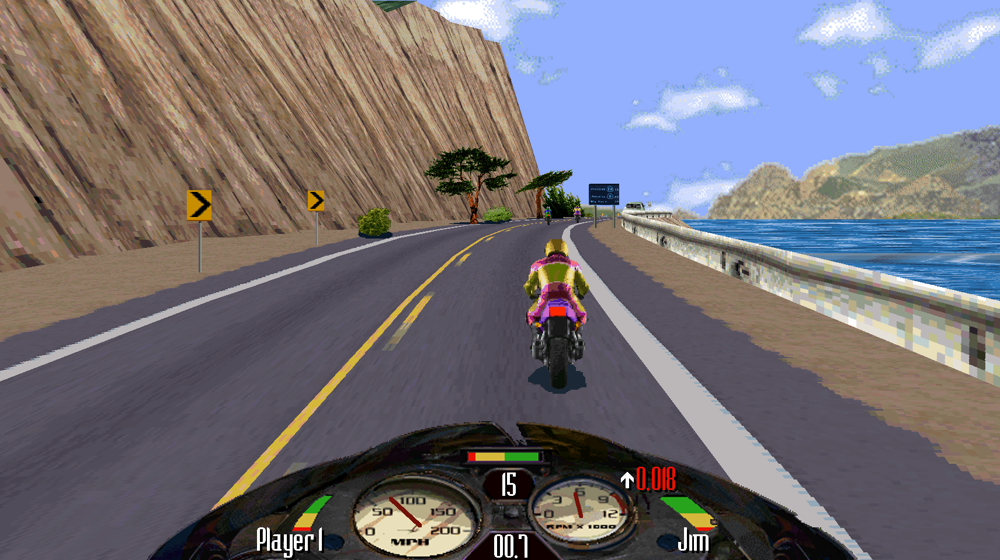
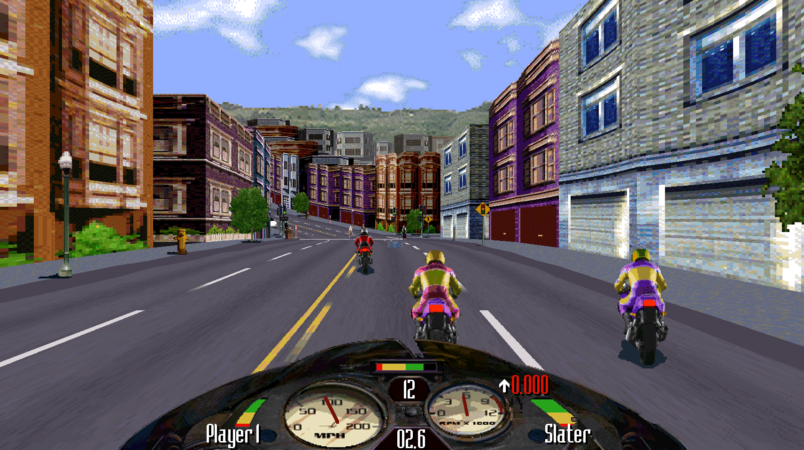
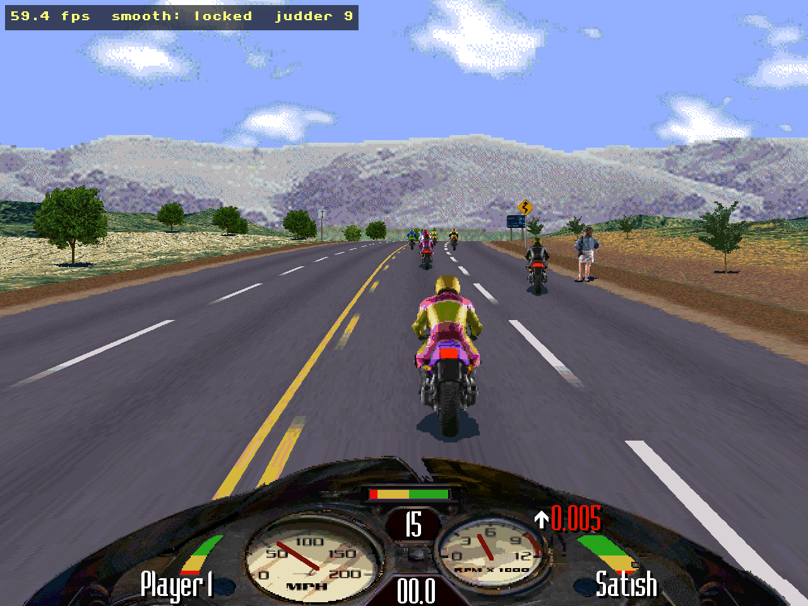
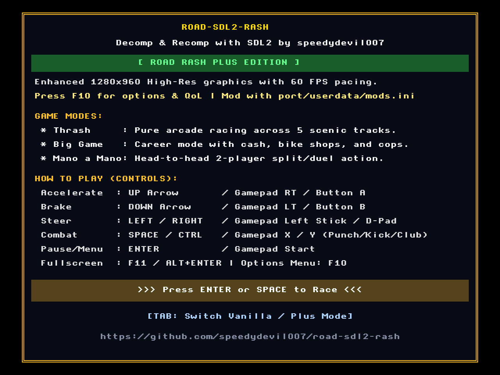
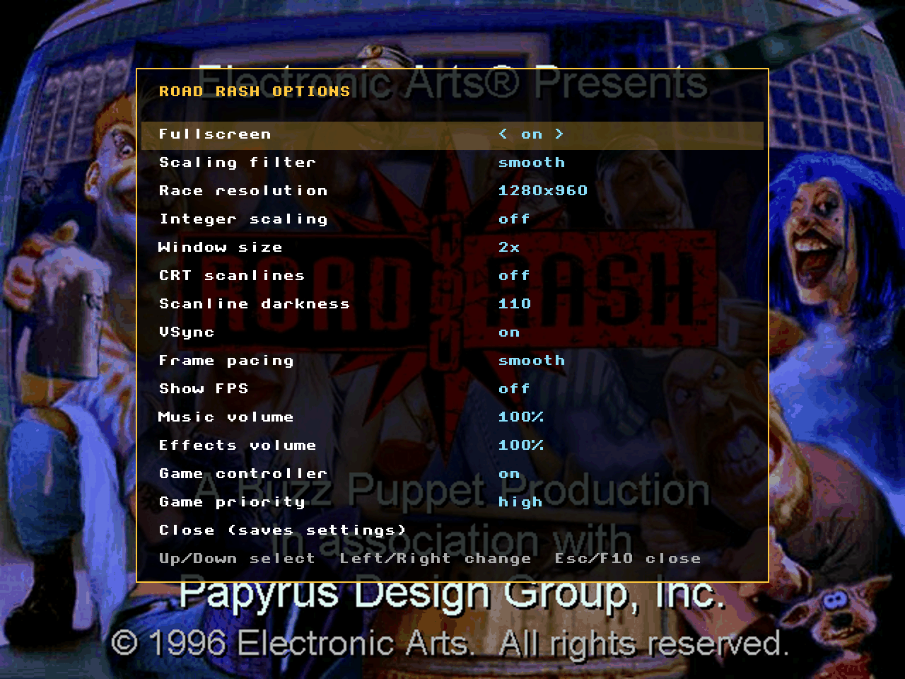

# road-sdl2-rash: Road Rash (1996 PC) Native Port & Web Edition

[](https://recompstore.com/dev/speedydevil007)
[](https://ko-fi.com/speedydevil007)
[](#download--play)
[](#licenses--legal)
[](#download--play)

**road-sdl2-rash** is a native 64-bit port of the 1996 PC game **Road Rash**, translated from the original x86 machine code into portable C over **SDL2**. No DOSBox, no emulator, no Wine. It runs on **Windows 10/11**, **Linux**, **Steam Deck** and in **web browsers**.

Play it as it was in 1996 (**Vanilla**), or switch to **Road Rash Plus**: high resolution, a 16:9 wide view, a longer draw distance and smooth 60 FPS pacing, with the race itself unchanged.

**A 1.5-Year Milestone:** I've been working on reverse engineering, lifting, and rebuilding this project for the last 1.5 years, and it is now finally ready for release! Thanks to LLMs.

<p align="center">
  
</p>
<p align="center">
  <em>Road Rash Plus: the 16:9 wide race view with the longer draw distance</em>
</p>

---

## Road Rash Plus

Press **TAB** on the welcome screen to switch between Vanilla and Plus. Every Plus setting is in the **F1** options menu, and the wide view, the draw distance and the in-race music are off until you turn them on.

| | Vanilla (1996 authentic) | Road Rash Plus |
| :--- | :--- | :--- |
| **Resolution** | 640×480 | **1280×960**, drawn by the game's own software rasterizer |
| **Screen shape** | 4:3, pillarboxed on wide screens | 4:3, or the **16:9 wide race view** |
| **Draw distance** | 32 road segments | 32, or **48 / 64** with a fade into the distance |
| **Frame pacing** | Original timing | **Smooth 60 FPS** presentation with VSync |
| **Scaling filter** | Smooth (Catmull-Rom) by default; sharp, nearest and linear to choose from | Same |
| **Gameplay** | Bit-exact 1996 physics, AI and rules | The same rules; optional tuning preset |

### What Plus adds

* **16:9 wide race view.** The race fills a widescreen display. The game draws the extra road, terrain, buildings and traffic on both sides itself; the dashboard stays in the middle.
* **Longer draw distance.** *Far* and *farthest* draw the road and scenery 48 or 64 segments ahead in place of 32, fading gently toward the horizon. Traffic and racers appear at the original distance.
* **1280×960 high resolution.** Four times the pixels of the original, with crisp HUD text and gauges.
* **Smooth 60 FPS pacing.** A frame scheduler presents the game evenly, without the original's uneven timing.
* **Plus tuning preset (optional).** `mods-plus.ini` lowers air drag for a higher top speed, makes rivals feud harder, sharpens the starter bike's brakes and improves off-road recovery. See [Modding](#modding).

The wide view and the draw distance only change what is drawn: a race plays out exactly the same with them on or off.

<p align="center">
  
  
</p>
<p align="center">
  <em>Wide view in town &bull; High resolution in the classic 4:3 view</em>
</p>

---

## In Every Mode

* **Full controller support.** Xbox, PlayStation, Switch Pro and Steam Deck controllers work out of the box: analog steering, triggers for throttle and brake, and the game's own "Configure Input" screen for remapping.
* **Smooth scaling filter.** The picture is scaled to your display with a Catmull-Rom filter by default. Sharp, nearest, linear, integer scaling and CRT scanlines are in the options.
* **Options menu (F1).** Fullscreen, filter, resolution, VSync, volumes, controller and more, changeable mid-race.
* **Native performance.** The game's code runs directly on your CPU as compiled C, with no emulation layer in between.
* **Faithful audio.** MIDI music through [TinySoundFont](https://github.com/schellingb/tinysoundfont) with the game's own AWE32 instrument banks and the GeneralUser GS SoundFont. Optional **in-race music** plays the soundtrack through the races.
* **Works with the Steam edition.** The files of *Road Rash* on Steam (the 30th Anniversary release) work as well as the 1996 CD's.
* **Videos.** With the game's `VIDEO` folder copied in, the logos, the intro and the race videos play, decoded by the port itself.
* **Checked against the original.** 14 scripted race replays must match the original game's results frame for frame before a build is released.
* **Classic HUD toggle (F10)** and the original Escape-to-quit prompt in races.
* **Plays in the browser.** Drop your game data onto the web page and race in Chrome, Firefox, Safari or Edge.

<p align="center">
  
  
</p>
<p align="center">
  <em>Welcome screen &bull; F1 options menu</em>
</p>

---

## Download & Play

**Get the latest release:** [Releases](https://github.com/speedydevil007/road-sdl2-rash/releases/latest), or play in the browser at **https://speedydevil007.github.io/road-sdl2-rash/**

This is a "bring your own game" port: **no game files are included.** Copy these from your own copy of Road Rash into the port's folder, next to the program, without renaming anything:

| Your copy | Copy these |
| :--- | :--- |
| **Steam** (30th Anniversary release) | `RoadRash95.exe`, `AUDIO/`, `DATA/`, `IMAGES/`, `TEXT/`, `VIDEO/` (in Steam: right-click the game → Manage → Browse local files) |
| **1996 PC CD-ROM or ISO** | `ROADRASH.EXE`, `AUDIO/`, `DATA/`, `IMAGES/`, `TEXT/`, and `VIDEO/` for the videos |

The port reads the files and changes nothing in them. The Steam edition is supported for its `RoadRash95.exe` of October 2026; if Steam updates the game and the port says it does not know the file, get the port's newer release. The web edition takes the 1996 files only.

| Platform | Folder | How to start |
| :--- | :--- | :--- |
| **Windows 10 / 11** | [`windows/`](windows/) | Copy the game files beside `RoadRashPort.exe` and double-click it. If SmartScreen appears: "More info" → "Run anyway". |
| **Linux & Steam Deck** | [`linux/`](linux/) | Copy the game files beside `roadrash.sh`, then `chmod +x roadrash.sh roadrash-port && ./roadrash.sh`. On a Deck, add `roadrash.sh` as a Non-Steam Game. |
| **Web** | [`web/`](web/) | Build `index.data` with `python3 web/pack_game_files.py <folder-with-gamefiles>`, then drop it onto the page (or serve locally with `python3 web/serve.py 8765`). |

**Requirements:** 64-bit Windows 10/11, or any x86-64 Linux from 2012 on (glibc 2.17+), or a current desktop browser. Nothing to install: SDL2 ships with the Windows build and is built into the Linux one. macOS, ARM and 32-bit systems have no native build; the web edition is the way to play there (untested). About 40–55 MB for the program plus about 43 MB of game files.

**Tested so far:** scripted races match the reference results on Windows 11 and Ubuntu 22.04, and in Chrome. The Steam Deck, Windows 7/8.1 and the other browsers are untested; reports are welcome.

---

## Controls

| Action | Keyboard | Gamepad |
| :--- | :--- | :--- |
| **Steer** | Left / Right | Left stick / D-Pad |
| **Accelerate** | Up | Right trigger / A |
| **Brake** | Down | Left trigger |
| **Attack** (punch, kick, club) | Space / Ctrl / Alt | X / Y / LB (left), B / RB (right) |
| **Nitro** (nitro bikes) | N | A |
| **Pause** | Pause | Start |
| **Quit the race** | Esc (asks first; Esc again quits) | — |
| **Next music track** | — | Back / Select |
| **Confirm / Back in menus** | Enter / Esc | A or Start / B or Back |
| **Options menu** | F1 (also Shift+F10 or `` ` ``) | — |
| **HUD mode** | F10 | — |
| **Fullscreen** | F11 / Alt+Enter | — |
| **Quit the game** | F12 | — |

---

## Modding

Both the desktop and web builds read `port/userdata/mods.ini`. Every line ships commented out, so the game starts with its 1996 balance. Remove the `#` from a line to turn it on:

```ini
rival_feud_percent = 200          # rivals fight each other more
physics_air_drag_percent = 70     # higher top speed
bike.swallow.brakes = -150        # sharper starter-bike brakes
```

For the Plus tuning preset, copy `port/userdata/mods-plus.ini.example` to `port/userdata/mods.ini`. [MODS.md](MODS.md) documents every setting.

> [!NOTE]
> **Source code:** the complete decompiled C source (~97,000 lines of structured, typed, readable C with modding hooks and tools) is in final cleanup and will be open-sourced soon.

---

## Support the Project

If you enjoy playing this modern port or appreciate the 1.5 years of reverse engineering and binary lifting work that went into reviving Road Rash (1996 PC), consider buying me a coffee!

<p align="left">
  <a href="https://ko-fi.com/speedydevil007">
    
  </a>
</p>

Your support directly funds ongoing retro game preservation, source code cleanup, additional platform testing, and future feature developments.

---

## Cryptographic Release Verification

Official release assets, git commits, and tags are cryptographically signed by **speedydevil007** using GPG to guarantee authenticity and integrity.

* **Signer:** `speedydevil007 <349187409+speedydevil007@users.noreply.github.com>`
* **GPG Key ID:** `7FA03C6926F817D3`
* **Key Fingerprint:** `CBE3 BDA4 A213 BFD1 56B9  2042 7FA0 3C69 26F8 17D3`
* **Public Key:** Included in repository as [RELEASE_KEY.pub](RELEASE_KEY.pub)

### Verifying Release Assets

```bash
# 1. Import speedydevil007's public key
gpg --import RELEASE_KEY.pub

# 2. Verify the cryptographic signature on the checksum manifest
gpg --verify SHA256SUMS.asc SHA256SUMS

# 3. Verify file hashes
sha256sum --check SHA256SUMS
```

---

## Special Thanks & Community Credits

A big thank you to the awesome community members helping test, debug, and refine **road-sdl2-rash**:
* **[@sergiofrias](https://github.com/sergiofrias)** — For diagnosing the initial scrambled gamepad mappings, sharing disassembly and hex analysis, and testing virtual key codes (Issue #1).
* **[@adrianflk](https://github.com/adrianflk)** — For flagging the classic `F10` HUD toggle conflict, identifying the "Configure Input" joystick-left locking bug, and reporting display pillarbox margin artifacts (Issue #2).

---

## Licenses & Legal

* **Road Rash** is a registered trademark of Electronic Arts Inc.
* This project is a non-commercial reverse engineering and recompilation project created strictly for preservation, education, and platform interoperability.
* No proprietary art, sound, video, courses, or executable binaries belonging to Electronic Arts are hosted or distributed in this repository.
* Open-source components:
  * **SDL2:** zlib license ([licenses/SDL2-LICENSE.txt](windows/licenses/SDL2-LICENSE.txt))
  * **TinySoundFont:** MIT license ([licenses/TinySoundFont-LICENSE.txt](windows/licenses/TinySoundFont-LICENSE.txt))
  * **GeneralUser GS SoundFont:** S. Christian Collins license ([windows/port/assets/GeneralUser-GS-LICENSE.txt](windows/port/assets/GeneralUser-GS-LICENSE.txt))
